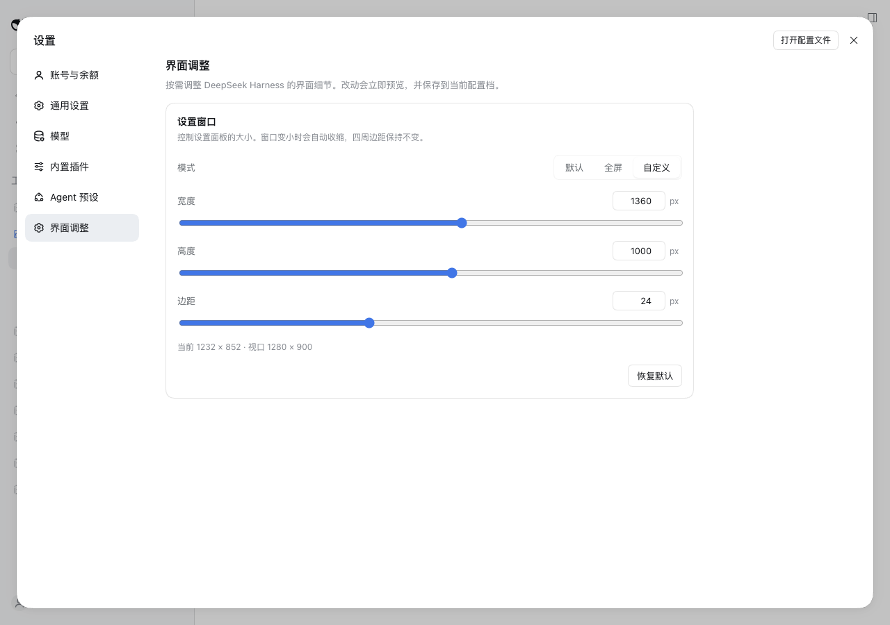

# dsh-tweakit

[](https://github.com/zhanganmv/dsh-tweakit/actions/workflows/ci.yml)
[](https://www.npmjs.com/package/dsh-tweakit)
[](LICENSE)
[](docs/development.md)

**把 DeepSeek Harness 的设置窗口，调成你顺手的大小。**

`dsh-tweakit` 在设置里加一个 **界面调整** tab：默认、全屏、自定义三种尺寸模式，实时预览、自动保存、重启后还在。它也是后续所有界面 tweak 的统一入口。

<p align="center">
  
</p>

## 为什么装它

DSH 的设置面板固定 **800×800**：在 4K 屏上浪费空间，在 1366×768 的笔记本上又显得局促。常见的做法是装一个只注入 CSS 的本地插件，把尺寸写死成 1360×1000——想改一次还得改代码。

`dsh-tweakit` 把这件事变成设置项：

- **三种模式**：保持原生 / 全屏铺满 / 自定义宽高，边距 0–64px 可调；
- **实时预览**：拖动滑杆，面板立刻跟着变，不需要刷新；
- **持久化**：通过 DSH 官方 settings 服务保存，换端口、重启应用都不丢；
- **可逆**：切回「默认」或卸载插件，样式节点立即移除，DSH 恢复原样；
- **为扩展而生**：字段是声明式的，后续字号、圆角、间距等 tweak 复用同一套表单与 tab。

## 安装

### Web profile

```bash
dsh plugin --profile web add -w dsh-tweakit
```

`-w` 不能省：profile 目录本身是 pnpm workspace root。

### Desktop

桌面端的 `desktop` profile 由应用独占，请在应用内的「插件」页安装 npm 包 `dsh-tweakit`。不要在和桌面应用同时运行时用 CLI 修改该 profile。

> 如果之前装了其它强制设置面板尺寸的插件，先卸载它：它们都靠 `!important` 抢同一个面板，同时存在会互相覆盖。

安装后打开 **设置 → 界面调整**；如果 tab 没出现，重启一次 `dsh` 进程。

### 升级与卸载

```bash
# 升级：重新执行安装命令；如果 pnpm 命中缓存，追加 --force 重新拉取
dsh plugin --profile web add -w dsh-tweakit@latest --force

# 卸载
dsh plugin --profile web remove dsh-tweakit
```

## 使用

| 模式      | 行为                                 | 实际尺寸                                                                                 |
| --------- | ------------------------------------ | ---------------------------------------------------------------------------------------- |
| `default` | 完全不接管，保持 DSH 原生 800×800    | 不注入任何样式                                                                           |
| `full`    | 全屏，保留自定义边距                 | `w = 100vw - 2·margin`；`h = 100vh - 2·max(margin, overlayTop)`                          |
| `custom`  | 自定义宽、高、边距；超出视口自动收缩 | `w = min(width, 100vw - 2·margin)`；`h = min(height, 100vh - 2·max(margin, overlayTop))` |

`overlayTop` 是 macOS 交通灯预留的顶部安全区。即使边距设为 0，面板也不会钻到标题栏下面。窗口宽度 `< 768px` 时不接管，交给 DSH 自己的移动布局。

首装默认值是 `custom / 1360×1000 / margin 24`，接近大屏下常见的设置面板尺寸。点「恢复默认」会清空用户层配置，回到这组默认值。

## 兼容与权限

- **DSH**：`0.2.1-rc.3` 实测通过；web 与 desktop profile 均可。更早版本未验证。
- **运行时**：Node ≥ 22.6，pnpm 9。
- **只使用公开扩展点**：`settings.section` 槽位、`ctx.configForms`、`ctx.locale`；不 patch DSH 源码、不改 hash 类名。
- **权限最小化**：不发起网络请求、不读取凭证、不写业务文件；只读写自己的 settings 命名空间 `dsh-tweakit`。
- **作用范围**：只向设置面板 `[role="dialog"][data-shortcut-modal="settings"]` 注入尺寸样式。
- **已知限制**：依赖上面的 `data-shortcut-modal` 标记；如果未来 shell 改名，tab 会显示“未检测到设置面板标记”的提示，需要跟进适配。

## 路线图

| 能力                             | 状态     |
| -------------------------------- | -------- |
| 设置窗口尺寸（默认/全屏/自定义） | ✅ 0.1.0 |
| 字号与信息密度                   | 候选     |
| 圆角与间距                       | 候选     |
| 侧栏 / 内容区宽度                | 候选     |
| 动效与过渡                       | 候选     |

候选不是承诺，按 issue 的 👍 和实际反馈排期。想加什么，欢迎开 issue 描述你的使用场景。

## 参与贡献

- **报 Bug / 提建议**：开 [issue](https://github.com/zhanganmv/dsh-tweakit/issues/new)，附 DSH 版本、profile、复现步骤和截图（UI 问题最好有录屏）。
- **改代码**：开发环境、测试、新增 tweak 的完整步骤见 [docs/development.md](docs/development.md)。
- **给 AI agent**：仓库约定写在 [AGENTS.md](AGENTS.md)。
- **设计先行**：每个功能先写 `docs/features/` 下的需求文档；不可逆决策补一篇 ADR。
- **PR 要求**：`pnpm check` 通过；UI 改动附前后截图；文档与代码同批提交。

## 文档

- [文档索引](docs/README.md)
- [开发指南](docs/development.md)
- [设置窗口尺寸 — 需求设计](docs/features/2026-11-09-settings-window-size.md)
- [插件架构设计](docs/architecture/plugin-architecture.md)
- [ADR-0001：用 DSH settings 服务持久化偏好](docs/architecture/decisions/0001-persist-prefs-in-dsh-settings.md)
- [ADR-0002：设置面板尺寸三模式](docs/architecture/decisions/0002-settings-panel-sizing-modes.md)
- [ADR-0003：配置驱动的 tweak 表单](docs/architecture/decisions/0003-config-driven-forms.md)
- [贡献指南](CONTRIBUTING.md)

## English

**dsh-tweakit** adds an **Interface** tab to DeepSeek Harness settings. The first tweak resizes the settings dialog — `default`, `full`, or `custom` (width, height, margin) — with live preview and persistence through DSH's settings service. It is also the base for future UI tweaks.

```bash
dsh plugin --profile web add -w dsh-tweakit
```

Tested with DSH 0.2.1-rc.3 on the web and desktop profiles. It does not patch DSH, make network calls, or read credentials. Development setup: [docs/development.md](docs/development.md).

## License

[MIT](LICENSE)

---

如果它帮你少改了一次 CSS，欢迎点个 ⭐。
